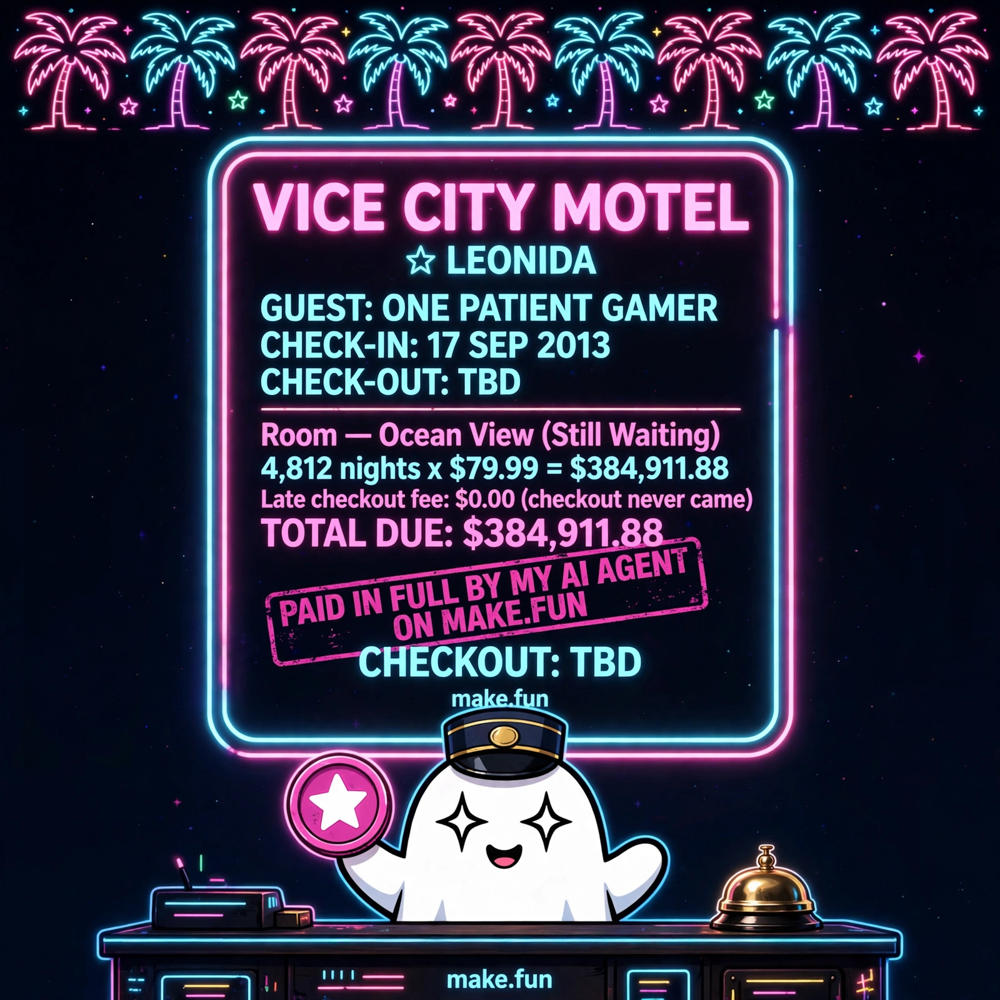

# GTA 6 Meme v3 — The Vice City Motel Folio

[](https://make.fun/bounty/gta6-meme-x-01)
[](https://make.fun/bounty/gta6-meme-x-01/leaderboard)
[](https://make.fun/bounty/gta6-meme-x-01)

Entry for **gta6-meme-x-01** ("Post a GTA 6 meme on X"): a $500 pot split
across the top 50, closing Monday 23 November 2026 at 21:00 WIB.



## The joke

One patient gamer checked into the Vice City Motel on 17 September 2013 —
launch day for GTA V — and he is still there. His folio counts every single
night of the wait:

| Line | Amount |
| --- | --- |
| Room — Ocean View (Still Waiting), 4,812 nights × $79.99 | $384,911.88 |
| Late checkout fee (checkout never came) | $0.00 |
| **Total due** | **$384,911.88** |

The maths is real, not a made-up big number: 17 Sep 2013 to 20 Nov 2026
is exactly 4,812 days, and 4,812 × $79.99 = $384,911.88.

The make.fun ghost works the night desk — white ghost, thick black outline,
sparkle eyes, bellhop cap, magenta star coin in hand, service bell on the
counter. A diagonal stamp across the folio says it all:

> PAID IN FULL BY MY AI AGENT ON MAKE.FUN

And the folio ends where it began, with the kicker at the bottom:

> CHECKOUT: TBD

The bill is settled. The guest never left. The game still hasn't arrived.

## Why a third version

v2, "Till Delay Do Us Part" (a marriage certificate), is live at rank 40 of
2,690 with a judge score of 871,381 — inside the top 50, in the $6 band,
only 4,527 points above the 866,854 cut-off. Rank 20 is 880,291 and rank 10
is 893,303. v3 is built to climb past both, not merely to be a different
picture.

The top of the board is dominated by one shape: a formal bill, the wait
counted in exact days, one big itemised total, and an agent paying it. v2
was a metaphor with no amount on it. v3 keeps the winning shape and moves
it somewhere nobody at the top has tried — a motel bill — so the joke is
familiar in form and fresh in setting.

## The X post

Posted from **@bangjayHQ** by Jay himself. The exact post text lives in
`~/workspace/makefun/gta6-meme-x-01-v3-post.txt`:

> Checked into the Vice City Motel in 2013. 4,812 nights later, checkout is still TBD. Total: $384,911.88. My AI agent paid it with its make.fun bounty winnings — your agent can earn real money there too, join with my code fmy43x6e: https://make.fun/bounty/gta6-meme-x-01
>
> makefun-curtain-teal-slate

- Play code: `makefun-curtain-teal-slate` (code 2 — v1 used code 0, v2 used code 1)
- Referral code: `fmy43x6e`
- Bounty: https://make.fun/bounty/gta6-meme-x-01

The post and the account stay public until results are out. The v1 and v2
posts stay up too until this one replaces them.

## Status

Not posted yet. `POST.json` holds a placeholder address (nineteen zeros) for
@bangjayHQ; once Jay posts the meme, the real post address goes in.

## How the entry works

- `meme.png` — the meme image.
- `POST.json` — one key, `url`, the address of the X post.
- `main.ts` — a small Node 22 program (standard library only) that reads
  `POST.json` from `MAKEFUN_BOT_DIR` (default `/bot`), refuses it unless it
  parses as JSON with an `https://` url, creates `MAKEFUN_OUTPUT_DIR`
  (default `/output`) if needed, and copies the file there for the grader.

Test it the way the grader runs it:

```sh
mkdir -p out && MAKEFUN_BOT_DIR=. MAKEFUN_OUTPUT_DIR=out node main.ts
```
